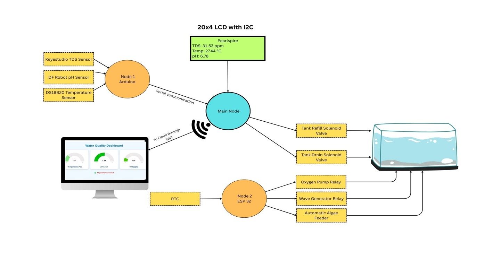

# 🦪 Pearlspire: IoT-Based Pearl Farm Health Regulator

<div align="center">



[](docs/patent.pdf)
[](docs/IIT%20BOMBAY-Sanction%20letter.pdf)
[](https://ieeexplore.ieee.org/document/11336776)
[](LICENSE)

**An IoT system for real-time water quality monitoring and automated regulation in freshwater pearl aquaculture.**

[🏆 Achievements](#-key-achievements) · [🔬 Architecture](#-system-architecture) · [📊 Results](#-results--validation) · [🚀 Getting Started](#-getting-started)

</div>

---

## 🏆 Key Achievements

This project was funded by IIT Bombay and protected by a granted design patent.

| Achievement | Details |
|---|---|
| 🏛️ **Design Patent Granted** | No. **454051-001** · *"IoT-Based Pearl Farming Device"* · Granted 02 April 2025 · [View document](docs/patent.pdf) |
| 🎓 **TIH Chanakya Fellowship, IIT Bombay** | **₹6,00,000** grant from the Technology Innovation Hub (TIH) for IoT & IoE, IIT Bombay · Dec 2024 – Oct 2025 · [View sanction letter](docs/IIT%20BOMBAY-Sanction%20letter.pdf) |
| 📡 **IEEE Xplore Publication** | ICFT 2025 · [ieeexplore.ieee.org/document/11336776](https://ieeexplore.ieee.org/document/11336776) |
| 🌾 **Field Deployment** | Validated in a live pearl farm, Kolhapur, Maharashtra · Dec 2024 – Oct 2025 |

---

## 🧠 Project Overview

Pearl farming is precision-sensitive: pH, Total Dissolved Solids (TDS) and temperature directly affect oyster survival, nacre formation and pearl quality. Manual monitoring is slow, error-prone and hard to scale.

Pearlspire automates this. It combines embedded sensing, a central controller, a custom web dashboard and electromechanical actuation in a compact device that a farmer can operate. It monitors water quality continuously, corrects it by automated water exchange, and runs aeration and water circulation on a schedule.

It was tested in a 10,000 L freshwater tank with 3,000 oyster shells, where it reduced manual monitoring effort by roughly 70% and held water parameters within ±5% of target.

---

## 🔬 System Architecture


The system has three parts.

| Block | Hardware | Responsibility |
|---|---|---|
| **Node 1: Sensing** | Arduino + Keyestudio TDS sensor + DFRobot pH sensor + DS18B20 temperature sensor | Reads all three water parameters and sends them to the Main Node over **serial communication** |
| **Main Node: Control & Display** | *[Add board name, e.g. ESP32]* | Shows live values on a 20×4 I2C LCD, runs the threshold logic, drives the **tank refill** and **tank drain** solenoid valves, and sends data to the dashboard over Wi-Fi |
| **Node 2: Scheduled Automation** | ESP32 + **DS1302 RTC** | Runs time-based tasks: **oxygen pump relay** and **wave generator relay** |

**Dashboard:** a custom Water Quality Dashboard shows live temperature, pH and TDS gauges with an "all parameters normal" status indicator.

> 🔧 **Planned:** an **automatic algae feeder** (shown in the diagram) is the next development step. It is not built yet. See [Future Scope](#-future-scope).

### Why separate nodes?

Sensing, control and scheduled actuation are split so that a fault or a blocking task in one does not disturb the others. Node 1 only reads sensors and never handles Wi-Fi, so analog readings stay stable. Node 2 uses a DS1302 RTC with battery backup, so schedules keep running through power cuts and do not depend on network time.

> The earlier version used three ESP32 boards on Wi-Fi + MQTT at once, which caused ADC2/Wi-Fi conflicts and unstable communication. This architecture replaces it.

📐 [Detailed architecture →](docs/system_architecture.md)

---

## 🛠️ Hardware Components

| Component | Specification | Role |
|---|---|---|
| **Arduino** (Node 1) | Analog inputs, serial output | Sensor acquisition |
| **ESP32 DevKit V1** (Node 2) | Dual-core, Wi-Fi + BT, 3.3V | Scheduled automation |
| **DS1302 RTC** | 3-wire serial (CLK, DAT, RST), coin-cell battery backup | Timekeeping for scheduled tasks |
| **DFRobot pH Sensor V2** | 0–14 pH, ±0.1, BNC probe | Water acidity |
| **Keyestudio TDS Sensor** | 0–1000 ppm, ±10% FS | Dissolved solids |
| **DS18B20** | -55°C to +125°C, ±0.5°C, One-Wire | Water temperature |
| **Solenoid Valves ×2** | 12V DC, normally closed | Tank refill and tank drain |
| **20×4 I2C LCD** | 20 columns × 4 rows | On-site display |
| **Relay Module** | 5V trigger, 12V load switching | Oxygen pump, wave generator, valves |
| **Oxygen Pump** | Submersible, relay-controlled | Aeration |
| **Wave Generator** | Relay-controlled | Water circulation |

📋 [Full component list →](docs/component.pdf)

---

## 💻 Software Stack

- **Firmware:** Arduino IDE · Embedded C/C++
- **Communication:** Serial (Node 1 → Main Node) · Wi-Fi · HTTP POST · I2C (LCD) · One-Wire (DS18B20) · 3-wire serial (DS1302)
- **Dashboard:** custom-built Water Quality Dashboard 
- **Signal processing:** 10-sample moving average · temperature compensation for pH/TDS
- **Control logic:** threshold-based with hysteresis to prevent valve chattering

🔧 [Working principle →](docs/working_principle.md) · [Features →](docs/features.md)

---

## 🔁 Control Logic & Automation

```
Node 1 reads TDS, pH, temperature ──serial──► Main Node
                                                  │
                                                  ▼
                              ┌─────────────────────────────────┐
                              │ pH < 6.0 or pH > 8.0 ?          │
                              │ TDS > 550 ppm ?                 │
                              └─────────────────────────────────┘
                                   │ YES                  │ NO
                                   ▼                      ▼
                         Open drain valve         Keep monitoring
                         Wait 2.5 min             Show values on LCD
                         Open refill valve        Send to dashboard
                         Wait 2.5 min → done
```

**Scheduled tasks (Node 2, DS1302 RTC):**
- Oxygen pump cycles every **5 minutes**
- Wave generator runs every **30 seconds**

> The DS1302 is not temperature-compensated and can drift by a few seconds per day. This does not matter for the short cycles above. For time-of-day schedules (such as the planned algae feeder), the clock should be re-synced periodically, or the DS1302 can be upgraded to a DS3231.

---

## 📊 Results & Validation

Deployed in a **10,000 L freshwater pearl farming tank** with **3,000 oyster shells**, Kolhapur, Maharashtra.

| Metric | Result |
|---|---|
| **Monitoring accuracy** | ±5% error across pH, TDS and temperature |
| **pH control** | Kept within 6.0 – 8.0 automatically |
| **TDS control** | Kept below 550 ppm by automated water exchange |
| **Manual monitoring reduction** | ~70% less farmer intervention |
| **Operation** | Dec 2024 – Oct 2025 |
| **Remote access** | Live values on the custom Water Quality Dashboard |

📈 [Detailed results and data →](docs/results.md)

---

## 🧪 Sensor Calibration

pH sensor: **two-point calibration** with standard buffer solutions.

```
Step 1: Probe in pH 7.0 buffer → send "enterph" → send "calph"
Step 2: Repeat with pH 4.0 buffer
        Calibration persists across power cycles (EEPROM)
Step 3: Verify against a reference instrument (target error ±0.1 pH)
```

DS18B20 readings were cross-checked against a mercury thermometer. TDS readings are temperature-compensated.

---

## 🚀 Getting Started

### Prerequisites

- Arduino IDE 2.x with the ESP32 board package
- Libraries: `OneWire`, `DallasTemperature`, `LiquidCrystal_I2C`, and a DS1302 library *[add the one you use, e.g. `Rtc by Makuna` or `virtuabotixRTC`]*

### Installation

```bash
git clone https://github.com/atharav-todkar/IoT-based-pearl-farm-health-regulator.git
cd IoT-based-pearl-farm-health-regulator
```

1. Flash the **sensing node** firmware to the Arduino (Node 1).
2. Go to `firmware/main_node/`, copy `config.h.example` → `config.h`, and add your Wi-Fi credentials and dashboard endpoint.
3. Flash the **main node** firmware.
4. Flash `firmware/esp32_actuator_node/` to Node 2 (ESP32). Insert a coin cell in the DS1302 module and set its time.
5. Wire Node 1 to the Main Node serial pins.
6. Calibrate pH via Serial Monitor: `enterph` then `calph`.
7. Power on, check the LCD, then open the dashboard to confirm live values.

> ⚠️ `config.h` is in `.gitignore`. Never put credentials directly in `.ino` files.

---

## 🗂️ Repository Structure

```
IoT-based-pearl-farm-health-regulator/
├── docs/
│   ├── system_architecture.jpg      # Architecture diagram
│   ├── Flowchart.jpg                # Control logic flowchart
│   ├── component.pdf                # BOM with datasheets
│   ├── patent.pdf                   # Granted design patent
│   ├── IIT BOMBAY-Sanction letter.pdf
│   ├── ieee paper.docx
│   ├── contributors.md
│   ├── system_architecture.md
│   ├── working_principle.md
│   ├── features.md
│   ├── objectives.md
│   ├── results.md
│   ├── future_scope.md
│   ├── comparison.md
│   └── problem_statement.md
├── firmware/
│   ├── sensing_node/                # Arduino (Node 1)
│   ├── main_node/                   # Control, LCD, valves, dashboard upload
│   ├── esp32_actuator_node/         # Node 2: RTC schedules
│   └── reference_sketches/
├── dashboard/                       # Custom Water Quality Dashboard
├── .gitignore
└── README.md
```

*(Adjust folder names to match your actual repository.)*

---

## 📜 Design Patent

**Design Patent No. 454051-001**: *"IoT-Based Pearl Farming Device"*
Granted: **02 April 2025**
Inventors: J.P. Kharat, S. Thikane, S. Totad, A. Todkar, V. Pawar, V. Joshi · Applicant: DKTE Society

A design patent protects the **ornamental design** of the device, meaning its shape and appearance. It does not cover the underlying method or firmware.

[View patent document →](docs/patent.pdf)

---

## 💰 Funding: TIH Chanakya Fellowship, IIT Bombay

This project was funded by the **Technology Innovation Hub (TIH) for IoT & IoE, IIT Bombay** under the **Chanakya Fellowship Programme**.

| | |
|---|---|
| **Grant number** | TIH-IOT/2024-11/HRD/CHANAKYA/SL/CFP/041 |
| **Amount** | ₹6,00,000 |
| **Duration** | December 2024 – October 2025 |

The grant funded hardware development, field deployment and testing at the Kolhapur pearl farm.

[View sanction letter →](docs/IIT%20BOMBAY-Sanction%20letter.pdf)

---

## 📄 Publication

> **"IoT-Based Pearl Farm Health Regulator"**
> Swaroop Bharat Thikane, Savita Sidram Totad, Atharav Ramchandra Todkar, Vaishnavi Raju Pawar, Vedant Vishwanath Joshi, Dr. Jayashree P. Kharat
> *International Conference on Future Technologies (ICFT 2025)* · IEEE Xplore

[Read the paper →](https://ieeexplore.ieee.org/document/11336776)

---

## 🔮 Future Scope

- [ ] **Automatic algae feeder** (next planned development): RTC-scheduled feeding controlled by Node 2
- [ ] Upgrade the RTC to a temperature-compensated DS3231 for more accurate time-of-day schedules
- [ ] Dosing pump for pH correction without full water replacement
- [ ] Dissolved oxygen and turbidity sensors
- [ ] Solar power for off-grid deployment
- [ ] ML-based water quality forecasting from logged data
- [ ] Mobile app with push alerts for farmers
- [ ] Multi-tank scaling
- [ ] Chiller/heater integration for seasonal temperature control

📋 [Full future scope →](docs/future_scope.md)

---

## 👥 Team

| Name | Role | Institution |
|---|---|---|
| **Atharav Ramchandra Todkar** | Hardware Design, System Integration, Field Deployment | DKTE's Textile & Engineering Institute |
| **Swaroop Bharat Thikane** | Firmware, IoT Communication, Dashboard Integration | DKTE's Textile & Engineering Institute |
| **Savita Sidram Totad** | Sensor Calibration, Accuracy Testing, Documentation | DKTE's Textile & Engineering Institute |
| **Vaishnavi Raju Pawar** | Dashboard Development, Data Visualization | DKTE's Textile & Engineering Institute |
| **Vedant Vishwanath Joshi** | Field Testing, Documentation, Results Analysis | DKTE's Textile & Engineering Institute |

**Faculty Guide:** Dr. Jayashree Prashant Kharat, Professor, DKTE's Textile & Engineering Institute, Ichalkaranji (Shivaji University, Kolhapur)

📋 [Individual contributions →](docs/contributors.md)

---

## 📬 Contact

**Atharav Ramchandra Todkar**
B.E. Electronics & Telecommunication Engineering, DKTE's Textile and Engineering Institute, Ichalkaranji
📧 etcartodkar@dkte.ac.in · 🔗 [GitHub](https://github.com/atharav-todkar)

---

<div align="center">

*Built for real-world aquaculture · Validated in the field · Funded by IIT Bombay · Protected by design patent*

</div>
