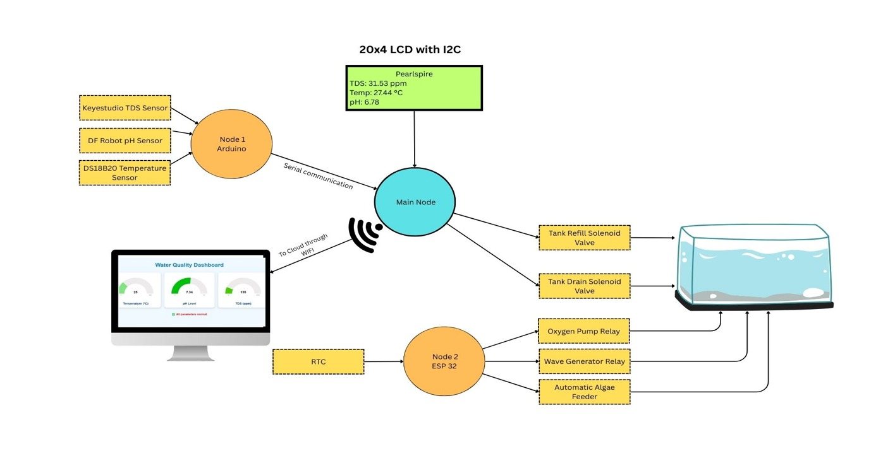

# System Architecture

The Pearlspire IoT-Based Pearl Farm Health Regulator is built on a four-layer architecture. Sensing, control and scheduled automation run on separate nodes, so a fault in one does not stop the others.



## Layer 1: Sensing Layer (Node 1, Arduino)

| Sensor | Specification | Output | Pin |
|---|---|---|---|
| **DFRobot pH Sensor V2** | 0–14 pH, ±0.1 | Analog | *[add pin, e.g. A0]* |
| **Keyestudio TDS Sensor** | 0–1000 ppm, ±10% FS | Analog | *[add pin, e.g. A1]* |
| **DS18B20 Temperature** | -55°C to +125°C, ±0.5°C | One-Wire digital | *[add pin, e.g. D2]* |

Node 1 only reads sensors. It applies the 10-sample moving average and temperature compensation *[confirm whether this runs on Node 1 or on the Main Node]*, then sends the values to the Main Node over **serial communication**. It does not use Wi-Fi, so its analog readings are not affected by radio activity.

## Layer 2: Control & Display Layer (Main Node)

**Board:ESP32**

- Receives sensor data from Node 1 over serial
- Shows live TDS, temperature and pH on a **20×4 I2C LCD**
- Runs the threshold logic with hysteresis (pH outside 6.0–8.0, or TDS above 550 ppm)
- Controls the **tank drain** and **tank refill** solenoid valves to run an automated water exchange
- Sends readings to the dashboard over **Wi-Fi**

## Layer 3: Scheduled Automation Layer (Node 2, ESP32)

- **DS1302 RTC** provides timekeeping, so schedules continue through power cuts (coin-cell backup)
- **Oxygen pump relay**: aeration cycle every 5 minutes
- **Wave generator relay**: water circulation every 30 seconds
- **Automatic algae feeder** *(planned, not built yet)*: RTC-scheduled feeding


## Layer 4: Dashboard Layer

- **Custom Water Quality Dashboard** shows live temperature, pH and TDS gauges and an "all parameters normal" status indicator
- Stack and hosting: 

## Data Flow

```
Sensors → Node 1 (Arduino) ──serial──► Main Node ──► LCD
                                           │
                                           ├──► Drain / Refill solenoid valves
                                           └──Wi-Fi──► Water Quality Dashboard

RTC (DS1302) ──► Node 2 (ESP32) ──► Oxygen pump · Wave generator · (Algae feeder, planned)
```

## Design Notes

- **Why Arduino for sensing:** The earlier version read analog sensors on the ESP32 while running Wi-Fi, which caused ADC2/Wi-Fi conflicts. Moving the sensors to a separate node avoids this.
- **Why a separate scheduling node:** Timed tasks (aeration, circulation, feeding) run independently of the sensing and water-exchange logic, so a long valve cycle never delays them.
- **RTC limitation:** The DS1302 is not temperature-compensated and can drift by a few seconds per day. This is fine for the short cycles above, but time-of-day feeding schedules will need periodic re-syncing or a DS3231.
