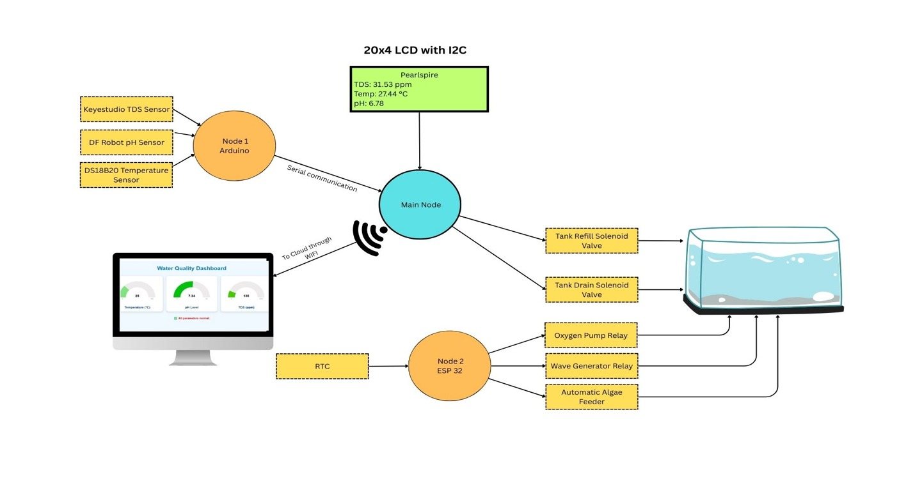

## ⚙️ Working Principle

Pearlspire monitors pH, TDS and temperature continuously, corrects out-of-range water by automated exchange, and runs aeration and circulation on a schedule. The work is split across three nodes: sensing (Node 1), control and display (Main Node), and scheduled automation (Node 2).

### 🔹 Step-by-Step Operation

1. **Data Acquisition (Node 1, Arduino)**

   * The pH, TDS and temperature (DS18B20) sensors are all read by Node 1
   * A 10-sample moving average is applied, and pH/TDS readings are temperature-compensated *[confirm whether this runs on Node 1 or the Main Node]*

2. **Data Transmission**

   * Node 1 sends the readings to the Main Node over **serial communication**

3. **Data Processing (Main Node)**

   * The Main Node compares the received values with predefined threshold limits

4. **Decision Making**

   * If pH < 6.0 or pH > 8.0, the system starts a water exchange *[confirm the lower limit: 5.9 or 6.0]*
   * If TDS > 550 ppm, the system starts a water exchange
   * Hysteresis prevents the valves from switching repeatedly near a threshold

5. **Automated Water Exchange (Main Node)**

   * The tank drain solenoid valve opens and drains for about 2.5 minutes
   * The tank refill solenoid valve then opens and refills for about 2.5 minutes

6. **Scheduled Automation (Node 2, ESP32 + DS1302 RTC)**

   * The oxygen pump relay switches every 5 minutes for aeration
   * The wave generator relay switches every 30 seconds for water circulation
   * These tasks run independently of the water-exchange logic
   * The automatic algae feeder will be added here in a future version (planned, not built yet)

7. **Display & Monitoring**

   * Live TDS, temperature and pH are shown on a 20×4 I2C LCD at the tank
   * The Main Node sends readings over Wi-Fi to the custom Water Quality Dashboard *[add upload interval]*

8. **Remote Access**

   * Users can watch live gauges and the "all parameters normal" status on the dashboard from a phone or computer

---

### 🔹 Key Highlights

* Automated water regulation with minimal manual intervention
* Real-time monitoring on the LCD and a custom web dashboard
* Sensing, control and scheduling on separate nodes, so a fault in one does not stop the others
* Sensor readings are taken on a separate Arduino, away from the Wi-Fi radio, which keeps analog readings stable
* Timed tasks continue through power cuts, since the DS1302 keeps time on its coin-cell battery
